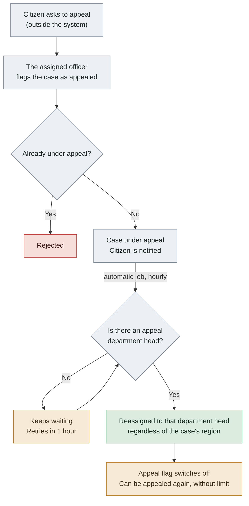
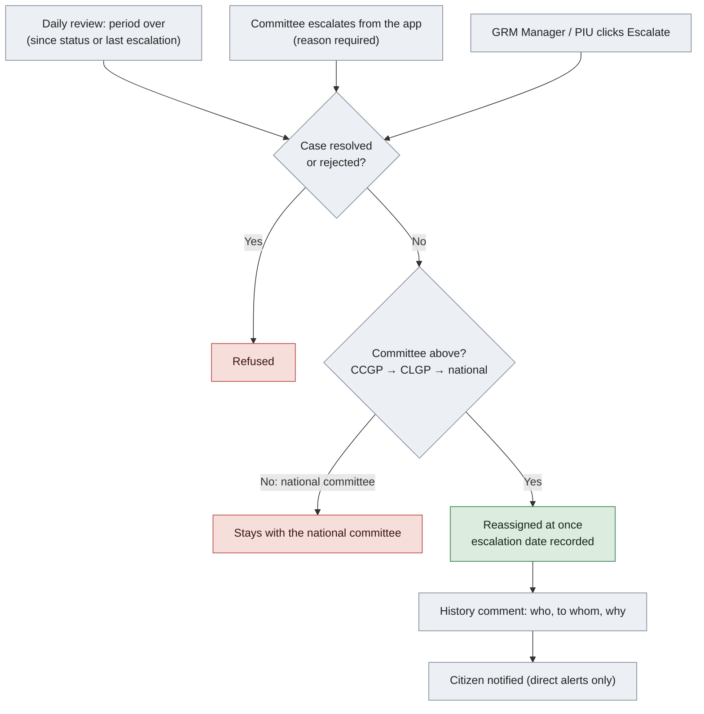

# How Appeals and Escalation Work Today

This document describes the **current behaviour of the code** — not the intended or planned design — for two GRM mechanisms: appealing a case, and escalating it (manually and automatically) across administrative levels.

---

## 1. The Appeal System

**What is it?** A yes/no flag that marks a case as "under appeal" and reassigns it to a fixed department responsible for reviewing appeals.

**Who can appeal a case?**
Only the person currently **assigned** to the case (the case manager handling it) can raise an appeal, through the case-update API. **There is no appeal button for the citizen**, neither in the app nor in the internal GRM dashboard. In practice, if a citizen wants to appeal, they have to ask the assigned officer (by phone, in person, and so on) to set the flag on their behalf.

**How is it raised?**
- The appeal flag can only go from "No" to "Yes". It cannot be cleared manually, and a case already marked as appealed cannot be appealed again while that appeal is pending.
- Nothing requires the case to be "resolved" or "closed" before appealing — technically it can be flagged in any status.
- Raising it automatically sends a notification to the citizen (email or SMS, depending on their contact method).

**What happens next?**
An automatic job runs **every hour**, picks up every case flagged as under appeal, and reassigns it to the **head of the appeal department configured for that issue category** (configured once per category, in the setup wizard). Three things are worth noting:

- This reassignment **does not follow the administrative hierarchy** (country → department → commune). It jumps straight to a fixed department, regardless of the case's territorial level.
- The place where the issue occurred (its location/region) **never changes** — only the person responsible for handling it does.
- Once reassigned, the appeal flag switches itself off (back to "No"), leaving the case free to be appealed again later.
- If the case's category has no appeal-department head configured, the case simply waits and is retried every hour.

**How many times can a case be appealed? Is there a limit?**
**There is no limit and no appeal counter in the current system.** No field records how many times a case has been appealed, and there is no maximum. The only rule is that a case cannot be appealed again while an appeal is still pending (the flag can only go No→Yes) — but since the flag resets itself after each reassignment, a case could in principle be appealed repeatedly without restriction.

### 1.1 Appeal flow diagram

**How to read it:** the only person who can start the cycle is the assigned officer, not the citizen. Once the appeal is raised, everything else happens on its own at the next hourly pass — and if no appeal department head is configured for that category, the case loops on the same step until someone configures one.

---

## 2. The Escalation System

**What is it?** The process by which a case is handed to the **committee of the next level** when it is not resolved in time or when the committee in charge cannot resolve it. The chain follows the COSO grievance committees:

**CCGP (village) → CLGP (commune) → national committee (country)**

Levels without a committee (arrondissement and département in Benin) are skipped. A committee is a department attached to an administrative level in the setup wizard, with **one account per committee** (its secretary). The routing code is in [`issues/models.py`](../src/issues/models.py) (`get_assignee_to_escalate`, `get_assignee_to_de_escalate`) and every escalation goes through [`issues/escalation.py`](../src/issues/escalation.py).

There are three ways to escalate — **automatic**, **voluntary from the mobile app** and **manual from the dashboard** — and they all behave the same way: the case is reassigned at once, the escalation date is recorded, a comment is added to the history (who, to which committee, why) and the citizen is notified if they asked for direct alerts. Resolved and rejected cases are never escalated, and a case already handled by the national committee cannot go higher.

### 2.1 Automatic escalation

Two scheduled background jobs (Celery) do the work:

1. **Flagging (once a day):** reviews every open case (not in a final or rejected status) and computes how many days have passed since the **start of the current period** — the latest of the moment the case entered its status and its last escalation. If that exceeds the "days to escalate" threshold configured for the status (setup wizard), the case is flagged. Counting from the last escalation gives each committee a full period: an escalated case no longer climbs one level per day up to the top.
2. **Execution (every 5 minutes):** reassigns every flagged case to the next committee and adds an automatic comment explaining that the processing time was exceeded. Each case is processed independently: an error on one case is logged and does not block the others. A case already at the national committee keeps its flag and is reported as "not escalable".

> Thresholds are still configured **per status, in calendar days**. Per-level deadlines in working days (3 / 3 / 5) and the 30-day rule for GBV cases are backlog item 9.

### 2.2 Voluntary escalation (mobile app)

At any time while working on a case, the committee in charge can escalate it to the next level, **with a mandatory reason**. The escalation is executed immediately by the server: the committee loses the case right away. If there is no higher committee, the request is refused with a clear message.

### 2.3 Manual escalation and de-escalation (dashboard)

A GRM Manager or authorised PIU staff member can escalate or de-escalate a case by hand with the buttons of the case page:

- **Escalate:** same as above, to the next committee up.
- **De-escalate:** sends the case back **down towards the place where the problem occurred** — national committee → CLGP of the case's commune → CCGP of the case's village. It never goes to another commune or village. De-escalation exists only as a manual action and does not notify the citizen.

### 2.4 Escalation flow diagram

### 2.5 Appeals vs. Escalation, side by side

| | Appeal | Escalation |
|---|---|---|
| Who triggers it | Only the officer assigned to the case | The clock (automatic), the committee in charge (app) or a GRM Manager / PIU (dashboard) |
| Where it reassigns to | A fixed department, configured per issue category | The committee of the next level (CCGP → CLGP → national) |
| Does it follow the territory? | No — jumps straight to a fixed point | Yes — along the committees above the case location |
| Is there a limit? | No counter, no cap | Stops at the national committee |
| Is the citizen notified? | Yes, when it is raised | Yes, on each escalation (direct alerts only) |
| What audit trail is left? | Only the current state (yes/no) and a free-text reason | A history comment for each escalation (who, to which committee, reason) and the date of the last one |

---

## 3. Administrative levels and how a case moves between them

Administrative regions are organised as a tree — for Benin, **Country → Département → Commune → Arrondissement → Village** — with a single root level (the country). Grievance committees sit on three of these levels only: village (CCGP), commune (CLGP) and country (national committee).

When a case moves "up" or "down" through escalation, what changes is **which committee is responsible**, not where the case is. The real location where the problem occurred — the case's region — is set once, when the case is created, and is **never modified** by an appeal or an escalation.

---

## 4. Things to be aware of

- **Appeals depend on the assigned officer, not the citizen.** If the expectation is that citizens can appeal directly, that capability does not exist in the system today.
- **There is no appeal limit.** If a cap is needed (for example "at most 2 appeals per case", or "appeals only go up to country level"), it has to be built — it does not exist today.
- **The automatic jobs (escalation flagging and execution, appeal reassignment) depend on a background process (Celery) that must run separately from the website.** If that process is not running in a given environment, automatic escalation and appeal reassignment simply do not happen, even though the code is there.
- **The citizen is notified of each escalation** (if they asked for direct alerts), in addition to creation, status changes, assignment and appeal. See [notifications.md](notifications.md).
